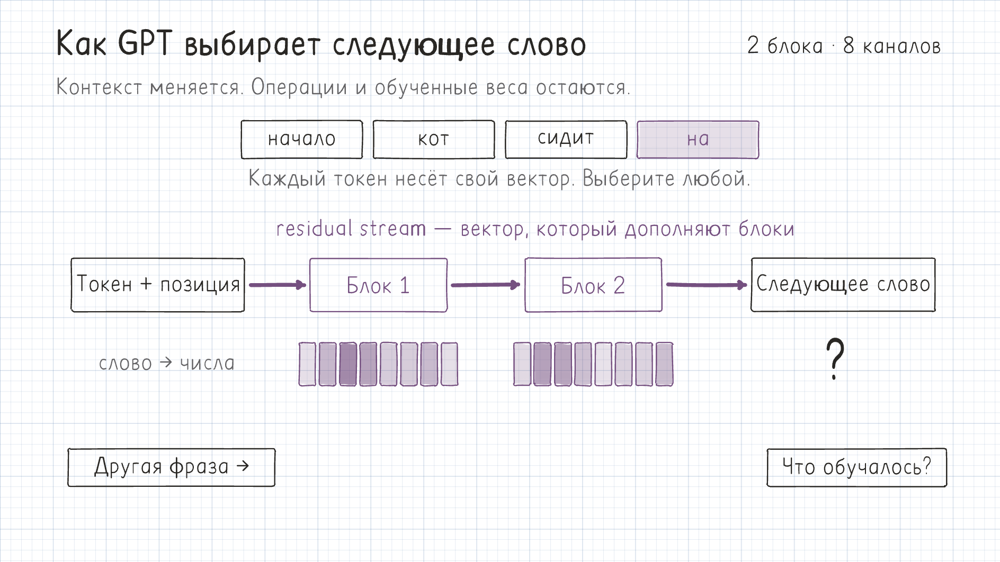

# Наглядные объяснения

Начни с вопроса зрителя и действия, которое раскрывает механизм. Сохраняй узнаваемый стиль предмета: рисованное объяснение для обучения, настоящий облик интерфейса для продуктовой инструкции. Показывай происхождение числа, преобразование или причинную связь. Голос опционален; объяснение должно быть понятным и без него.

## Короткий опыт из готового приёма

Для группировки целых предметов первый вызов — `story_create` с подходящими вопросу `count` и `divisor` в `document: {recipe: "division", inputs: {count, divisor}}`, названием проекта и новым `requestId`. Этих входов достаточно: библиотека задаёт устойчивые ID, рисунок, формулу, управления и последовательность «предметы → полные группы → остаток». Сначала показывается предмет; справку о расширениях читай, когда они нужны. Проверка пустого каталога и чтение GPT-исходника для этого шага не требуются.

Выбери небольшой пример, в котором можно увидеть причину и проверить границу. Для штатной последовательности оставляй стандартную партитуру; свои `chapters` нужен, когда вопрос требует другого действия или порядка внимания. После создания проверь реальный кадр и существенное изменение входа через `story_control` с командой `parameters`; переход к cue только перематывает рассказ. Значения и ревизии бери из наблюдаемой сцены. Уже принятые проверки компонента сохраняют силу; новая проверка относится к выбранным входам и вопросу зрителя.

Правки в той же карточке выполняет `story_edit(operations)`. [Компактный контракт](references/live-explanation.md) описывает ID, представления, партитуру и продолжение. Архив, голос и видео готовятся при выпуске. Подробное авторство ниже относится к развитию истории или собственной предметной логике.

## Связный визуальный рассказ

При развитии собственной истории прочитай [подачу и раскадровку](references/visual-storytelling.md), в том числе для тихого ролика. Выбери посильный для зрителя вывод и конкретный пример, на котором видна его причина. Веди узнаваемые предметы через связанные действия: предыдущий результат даёт повод для следующего шага. Название и формула закрепляют уже увиденную связь. Интерактивность позволяет изменить существенное условие и проверить свой прогноз на той же модели.

Манера — живое, точное научно-популярное объяснение рядом со зрителем. Запрещено заменять повествование рублеными лозунгами, парными номинативными заголовками и торжественной журнальной риторикой вроде «Большие расстояния. Общие зависимости.». Короткое название служит ориентации и навигации; оно не становится автоматически репликой или действием. В кадре обычно достаточно одной короткой естественной фразы у предмета и необходимых обозначений. Письмо от руки не оправдывает абзацы статьи. Длинную мысль раскрой действиями и последовательными короткими пометками; полный текст и источники оставь в доступном сопровождении.

Концентрированность означает ясный центр внимания и отсутствие лишнего. Оставляй место вокруг действующего предмета и время увидеть преобразование. Новый цвет, движение и подробность должны помогать объяснению. Проверь сам рассказ без звука, включая изменённый зрителем вход: можно проследить причину и предсказать новый результат. Технически исправная сцена ещё нуждается в этой содержательной проверке.

## Учебный рисунок

До компоновки назови, что зритель замечает первым, какую связь прослеживает и какой вывод получает. Размер, цвет и свободное место следуют этому порядку. Первый экран сохраняет читаемое целое; подробность открывается рядом с предметом.

Для собственной композиции вне готового приёма открой [кадр эталона](../../examples/gpt-model/preview.png) через `view_image`; читай [его исходник](../../examples/gpt-model/scene.js) адресно, когда он помогает выбранной постановке. «Как GPT выбирает следующее слово» — единственный поставляемый пример: общая модель связывает предмет, действие и пояснение. Переноси иерархию письма, зазоры и спокойную плотность чернил. Новая тема получает собственную композицию и предметную модель.

Рисунок интерактива и ролик составляй в одном кадре 16:9. `SceneShell` по умолчанию задаёт 1280×720 для заголовка, рисунка и предметных действий; `SceneStory` наследует этот кадр. Единственный плеер располагается под ним вне масштаба рисунка: области нажатия от 44 CSS px, текст от 16 CSS px. В чате и боковой панели всегда виден целый кадр. Используй штатную кнопку разворачивания карточки Codex; не добавляй собственные кнопки увеличения оболочки. Переход сохраняет состояние модели и рассказа. Размещай предмет в логических `shell.stage.clientWidth/clientHeight`, подписи и действия — у соответствующей геометрии. Прогноз отмечается на предмете, действие меняет модель, результат виден в том же рисунке. `svgButton` и `inkButton` дают нажатие и фокус; `shell.input` — параметры и историю.

Основной текст прямой, чёрный в светлой теме и светлый нейтральный в тёмной. Плотные чернила несут форму и текст; прозрачный маркер выделяет короткую мысль, деликатная штриховка — поверхность или часть. Цвет роли связывает предмет, формулу и действие. Контур сохраняет форму при перемотке. `handwriting: "heading" | "body" | "note"` у `lettering` и `paragraph` различает крупную мысль, пояснение и пометку; кириллица, цифры и математика используют то же перо при появлении и в готовом тексте. Проверь настоящую длинную фразу.

Лист прозрачен в обеих темах; спокойная серая сетка лежит поверх фона приложения только в предметной области. Заголовок текущей главы и режимы примыкают сверху на чистом поле общего кадра, компактный плеер — снизу. В измерительном рисунке сетка принадлежит поверхности: шаг, начало и камера совпадают с единицами модели, а `paper: false` у оболочки убирает дублирующий фон. Обычный рисунок использует сетку оболочки и `grid: false` у вложенной поверхности. Подписи находятся у объектов, стрелки показывают направление и причину, скобки — объединение. Графику передай названия осей в `xLabel`/`yLabel`, значения у точек через `plot.label`, приросты через `plot.interval`; заверши обновление модели вызовом `plot.layout()`. Общая раскладка учитывает полное перо, деления, линии и защищённые через `plot.avoid(element)` формулы и действия. В `Viewport3D` экранные подписи размещаются автоматически; `labelObstacles` защищает важную геометрию. Сохраняй эти владельцы, когда меняешь основу. Для предметных схем `node`, `pen`, `vector` и `svgButton` дают общие рисунок, нажатие и фокус. Подробности материалов — в [оформлении](references/motion.md#оформление).

Тетрадь и персонажную сценку всегда показывай разными кадрами. Запрещено помещать постановку внутрь листа в клетку. `CharacterStory` и `characterChapter` автоматически отдают декорации весь кадр 16:9 без внешней сетки и заголовка; для тетрадного разбора добавь отдельную `inkChapter`. Живая схема может находиться на доске персонажа, а затем открываться отдельным тетрадным кадром с той же моделью. Общие параметры, главы и плеер сохраняются.

## Работа в Codex

Для готового приёма используй `story_create(document)` → `story_edit(operations)` по [контракту](references/live-explanation.md). Создание открывает карточку; валидный частичный ввод может показать предварительный опыт до окончательного результата. Этот кадр ещё не подтверждает исходник или ревизию. Финальный документ использует тот же SceneHandle, дальнейшая правка доставляется в ту же карточку. Pin на точный установленный выпуск создаётся сразу, переносимый архив — при выпуске исходников.

Для новой предметной логики используй JS/TS: `story_create` без `document` и `example` создаёт нейтральный каркас; `example: "gpt-model"` явно копирует эталон. В `project` возвращаются `files`, `entry`, `runtime` и `sourceRevision`, подготовка продолжается заданием. Наполни каркас, проверь через `story_review`, затем покажи через `story_open(context)`. `story_help` читает API и эталон из закреплённой библиотеки; `story_open` также открывает сохранённую работу или явно выбранный эталон.

Контекст текущего кадра прикрепляется автоматически одним обновляемым снимком. Обычное обсуждение остаётся в чате. Передавай его `context` в следующие инструменты; при устаревшем состоянии или необходимости подробностей вызови `story_inspect`. Полная временная шкала и геометрия нужны только для конкретного вопроса. Не пересказывай технические IDs пользователю.

`story_find` находит cue, главу или предмет; учитывай тип результата при управлении. `story_control` меняет существующую сцену; простая пауза не требует предварительного inspect. Для проверки вычисленных значений передай `detail: "model"` в действие. Перемотка и исследование сохраняют исходники. Ручной ввод пользователя имеет приоритет. Новое готовое объяснение создавай через `story_create(document, context)` в текущей карточке; `story_navigate` используется для перехода к уже созданной работе. Оба пути сохраняют возврат к уроку. Проверяй состояние доставки: `prepared` ещё не подтверждает показ.

Для авторской правки передай `context` из предыдущего результата и новый `requestId`; при retry сохраняй исходный ID. Одна правка — один шаг отмены. Готовый приём редактируй через `operations`; сверяй принятый исходник с `shownSourceRevision` и ответом показанной сцены. Отчёт `prepared` без `rendered` не подтверждает наблюдённый кадр или скорость показа. Для JS/TS прочитай нужные файлы через `story_inspect` и объедини связанные `changes` в одну транзакцию: обычная сборка запускается автоматически. Watcher подхватывает файловые правки; новые изменения заменяют устаревшую подготовку. Точный API узнавай пакетно через `story_help(queries, context)`; справка доступна до сборки. `story_inspect(jobId, waitMs)` ждёт изменение задания до 15 секунд. Старый проект сохраняет свою библиотеку; обновляй её через явный `story_migrate`, с возможностью undo. При изменении API передай `changes` с обновлёнными исходниками в ту же миграцию: новый runtime и исходники проверяются вместе и применяются одной правкой.

Начинай с тихого объяснения. Когда озвучка уместна и ещё не выбрана, предложи её в чате. Если пользователь хочет голос, уточни недостающие пожелания к языку, тембру, манере и темпу; уже заданные пожелания используй без повторного вопроса. До этого не запускай синтез и загрузку голосовых моделей. В карточке нет панели выбора голоса, каталога и выпуска — эти действия агент выполняет через инструменты по запросу.

`story_voice` сохраняет выбор и включает синтез; mute лишь меняет слышимость текущей дорожки. По умолчанию используй локальный Higgs TTS 3 BF16 с принятым мужским образцом. Пользователь может выбрать другую локальную модель (`local`) или API (`api`); агент подключает конкретного провайдера по [контракту адаптера](references/voice-adapter.md). Системные голоса запрещены, в том числе через адаптер. Выбранного провайдера автоматически не меняй. До подготовки покажи требования выбранного варианта; для Higgs `enabled: true` запускает общую очередь Python, моделей, речи и разметки. Готовность конфигурации local/API не подтверждает доступность сервиса и качество голоса: проверь короткую реплику, её звук и метки. Правка реплики сохраняет cue IDs и переиспользует неизменённые фрагменты.

`story_review` проверяет выбранный вход и возвращает job. В `target` явно передай показанную сборку `{kind:"build",context}` либо рабочие исходники `{kind:"working",context}`. Выбери cue/интервал для состояний сцены или авторский `scenario` JSON для реального взаимодействия. Получи отчёт и кадры через `story_inspect(jobId)`. Для исследования записи используй возвращённую CLI-команду `inspect`: `--list changes` находит переходы, `--change ID|largest`, `--frame ID|INDEX` или `--at SECONDS` выбирает момент, `--step N` двигается от него по сохранённым кадрам. `--view pair|frame|onion|changes` возвращает `image`; `navigation.previous/next` содержит готовые команды. `--list objects --search TEXT` находит деталь, `--object ID --crop auto --max-size 0` увеличивает её по наблюдаемым границам. Для произвольной области доступен `--crop x,y,w,h`. Читай JSON и открывай его `image` в одном вызове инструментов по [примеру](references/motion.md#cli-и-изображение-одним-вызовом). Эти действия используют сохранённые кадры; `--out` нужен для полного подробного отчёта. Изменение изображения оценивай по замыслу сцены, сверяя чистую пару.

`story_produce` принимает тот же `target` и выпускает HTML, PNG, SVG поддерживающей сцены, видео, субтитры или исходный архив. Для текущих условий передай build target с контекстом наблюдённой сцены и `options.conditions:"current"` (HTML/PNG/SVG). Для MP4 выбери `options.video:{kind:"story"}` или `{kind:"interval",from,to}`. Retry сохраняет выбранный вход. Проверяй фактический результат через `story_inspect(jobId)`; `story_cancel` останавливает подготовку, `story_retry` продолжает проверенные этапы. Инструменты видео готовятся автоматически. Рабочие файлы сохраняются вне кэша плагина; пользовательские значения по умолчанию доступны через `story_preferences`. В обычной карточке остаются сцена и плеер; ссылки на выпуски возвращаются в результате инструмента.
SVG должен сохранять всю композицию вместе с заголовком и предметными действиями. `SceneShell` делает это для поддерживаемого векторного рисунка; при ограничении смешанной сцены выбирай PNG/HTML/MP4. Не подменяй весь кадр выгрузкой отдельного внутреннего SVG.

`options.silent:true` применяется до подготовки голоса: тихий HTML не загружает модели и кодировщик. При выпуске готовой сборки озвучка также исключается из результата; запись остаётся в исходном проекте. MP4 всегда имеет пропорции 16:9, по умолчанию 960×540. Задавай один из `width`/`height`; второй вычисляется, размеры округляются до единиц 32×18 px. Явная пара должна соответствовать 16:9. Проверяй фактические размеры в результате задания.

## Авторство и проверка

Исходники, библиотека и CLI находятся в одном комплекте. Из каталога этого навыка CLI запускается как `node ../../tools/scene.mjs`; у самостоятельного проекта после установки зависимости доступен `npx visual-story`.

Состав комплекта проверяй через `story_help` либо `examples --json`, доступные
импорты — через `api`. Каталог MCP, CLI и галереи содержит только `gpt-model`.
`new DIRECTORY` создаёт нейтральный проект; `--example gpt-model` копирует эталон.
Higgs готовится лениво через `story_voice`. Если системный
Node отсутствует, используй поставляемый `../../runtime/node` вместо `node`.

- Для готового живого приёма — [компактный контракт](references/live-explanation.md).
- Для выбора представления и сложного авторства прочитай [приёмы объяснения](references/authoring-guide.md) и [исходник эталона](../../examples/gpt-model/scene.js).
- Для рассказа и ручного исследования — [SceneShell и общий маршрут](references/scene-template.md).
- Для морфинга — [MathMorph и InkMorph](../../docs/morphing.md); для рассказа из преобразований — [MorphStory](../../docs/morph-stories.md).
- Для тензоров, срезов и происхождения результата — [единая модель данных](../../docs/tensors.md).
- Для подробного урока — [общий документ](../../docs/lessons.md): предположение → действие → объяснение результата.
- Для персонажей — [постановка](../../docs/characters.md); исходные glTF и SVG редактируются свободно.
- Для SVG/графика — [данные и публикация](references/data-plots.md); для вложенной модели — [камера и навигация](references/nested-explorer.md).
- Для озвучки — [сценарий и голос](references/narration.md); для выбранной пользователем модели или API — [подключение адаптера](references/voice-adapter.md). Это самостоятельный голос проекта.
- Для проверки движения — [наблюдение и кадры](references/motion.md#проверка).

Библиотека владеет плеером, камерой, геометрией, подписями и синхронизацией. Задавай предметную модель и смысловые метки; не создавай для каждой сцены собственные часы или копию общих контролов. Для адаптивной композиции используй `shell.layout`: логические размеры рисунка, фактический размер показа, `scale` и `compact`. В компактном кадре оставляй один основной предмет и раскрывай детали последовательно; существенные подписи сохраняют минимум 16 CSS px. Общие поля и историю оболочка переносит в «Условия» автоматически; выбор главы открывается через её заголовок. Общую ошибку исправляй у её владельца.

Проверь затронутые моменты на целевой поверхности: предмет действительно меняется, подпись остаётся связанной с ним, быстрый ввод предсказуем, кадр читается. Открой общий кадр учебного разбора и сопоставь с эталоном выше: весь рисунок, включая предметное управление, должен выглядеть как аккуратный пример в тетради. Для постановки отдельно проверь полноформатную декорацию, контакты и отсутствие тетрадного обрамления; затем перейди к главе разбора и обратно. Для нового оформления проверь узкую ширину, обе темы и клавиатуру. На узкой карточке проверь целый кадр и физические размеры плеера. Затем открой большую панель штатной кнопкой карточки: проверь реальные надписи, управление и `presentation().unreadableText`. Закрой панель средствами хоста и убедись, что в чате снова целый кадр без прокрутки; загрузка маленького кадра сама по себе читаемость не подтверждает. Передавай редактируемый результат и проверенные готовые файлы.
